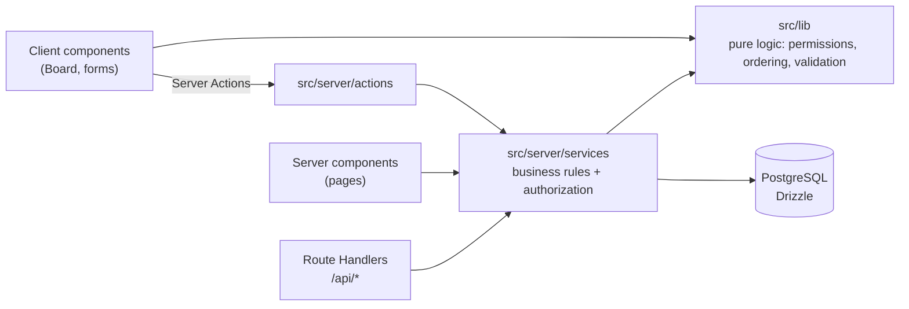

# Teamboard

A shared Kanban board for small teams, built as a full-stack Next.js application. Users sign up, create projects, invite teammates by email and move tasks between lanes with drag and drop. Everything from the database schema to the UI lives in this repository.

> **Live demo:** _add your Vercel URL here_ · demo login `demo@teamboard.dev` / `demo-password` (after `npm run db:seed`)

<!-- Add a screenshot or GIF of the board here:  -->

## Features

- Email and password sign-up and sign-in (Auth.js, JWT sessions, bcrypt hashing)
- Projects with three lanes; the creator is the **owner**, invited people are **members**
- Role-based permissions enforced on the server (owners manage people and delete anything; members create and move tasks and delete only their own)
- Drag and drop across and within lanes, with optimistic updates and rollback on error, plus full keyboard support
- Task priority and assignee
- A small REST API next to the server actions
- Responsive layout, light and dark theme, visible focus states, reduced-motion support

## Tech stack

| Area | Choice |
| --- | --- |
| Framework | Next.js 15 (App Router, Server Components, Server Actions, Route Handlers, Middleware) |
| Language | TypeScript (strict) |
| Database | PostgreSQL with Drizzle ORM and SQL migrations |
| Auth | Auth.js v5, Credentials provider |
| Validation | Zod, shared by client and server |
| UI | React 19, Tailwind CSS 4, dnd-kit |
| Tests | Vitest, React Testing Library, Playwright |
| CI | GitHub Actions with a PostgreSQL service container |

## Architecture



Requests come in three ways (pages, server actions and the REST API), and all of them go through the same **service layer**. Services take a `userId` explicitly instead of reading the session, which keeps them framework-independent and lets the integration tests call them directly. Actions and route handlers only handle the session, revalidation and turning errors into responses.

### Decisions worth discussing

**Fractional ordering.** Every task stores a float `position`. Moving a task sets it to the midpoint of its new neighbours, so a move is one `UPDATE` instead of renumbering the whole column. When two neighbours get closer than `MIN_GAP`, the column is rebalanced inside the same transaction (`src/lib/ordering.ts`, `src/server/services/tasks.ts`).

**One permission function.** `can(role, action)` in `src/lib/permissions.ts` is pure. The server uses it to enforce rules and the UI uses it to hide controls, so the two can't drift apart.

**404 instead of 403 for non-members.** Someone who isn't on a project gets "not found", so the API doesn't reveal which project ids exist.

**Optimistic drag and drop.** The board uses React 19 `useOptimistic` with a pure reducer (`moveTaskInBoard`). The card moves instantly; the server action then revalidates the page, and if it fails the board falls back to the server state and shows the error.

**Validation once, used twice.** Zod schemas in `src/lib/validation.ts` validate forms in the browser for fast feedback and are re-checked in the services, which never trust their input. IDs are validated as UUIDs before they reach the database.

## Testing strategy

| Layer | Tool | What it covers | Command |
| --- | --- | --- | --- |
| Unit | Vitest | Pure logic: ordering math, permission matrix, board reducer, schemas, error mapping | `npm test` |
| Component | Vitest + Testing Library | Rendering and behaviour from the user's side (labels, roles, validation messages), with server actions mocked | `npm test` |
| Integration | Vitest + real PostgreSQL | Service layer: permissions, cascades, ordering and rebalancing, duplicate emails | `npm run test:integration` |
| End-to-end | Playwright | Critical journeys in a real browser: sign-up, create project, add task, drag to Done, reload | `npm run test:e2e` |

Integration tests run against a real database because most backend bugs live in queries, constraints and transactions, which a mocked ORM would hide. Each test starts from empty tables, and the setup refuses to run if the database name doesn't contain `test`.

## Getting started

Requirements: Node.js 22 and Docker (or any PostgreSQL 16).

```bash
git clone https://github.com/<you>/teamboard.git
cd teamboard
npm install
cp .env.example .env        # then set AUTH_SECRET, e.g. `npx auth secret`
docker compose up -d        # PostgreSQL with `kanban` and `kanban_test` databases
npm run db:migrate
npm run db:seed             # optional demo data
npm run dev
```

Open http://localhost:3000.

### Scripts

| Script | Description |
| --- | --- |
| `dev` / `build` / `start` | Next.js development server, production build, production server |
| `lint` / `typecheck` | ESLint and `tsc --noEmit` |
| `test` | Unit and component tests |
| `test:integration` | Service tests against `DATABASE_URL_TEST` |
| `test:e2e` | Playwright (run `npx playwright install chromium` once) |
| `db:generate` | Create a new SQL migration after editing `src/db/schema.ts` |
| `db:migrate` / `db:seed` / `db:studio` | Apply migrations, add demo data, open Drizzle Studio |

## REST API

All endpoints require a session cookie and return JSON. Errors are returned as `{ "error": string }` with the matching status code (400, 401, 403, 404, 409).

| Method | Path | Description |
| --- | --- | --- |
| `GET` | `/api/projects` | Projects the current user belongs to, with task and member counts |
| `POST` | `/api/projects` | Create a project: `{ "name": string, "description"?: string }` |
| `GET` | `/api/projects/:projectId/board` | Columns with ordered tasks, members and the caller's role |

## Project structure

```
src/
  app/                 routes: landing, auth, projects, board, members, API
  components/          board (dnd-kit), forms, UI primitives
  db/                  Drizzle schema and client
  lib/                 pure, framework-free logic shared by client and server
  server/
    actions/           server actions (session, revalidation, error shape)
    services/          business rules and authorization
  auth.ts              Auth.js setup; auth.config.ts is the edge-safe part used by middleware
drizzle/               generated SQL migrations
scripts/               migrate and seed
tests/                 unit, component, integration
e2e/                   Playwright specs
```

## Deployment

The app deploys to Vercel with a managed PostgreSQL database (Neon, Supabase or Vercel Postgres). Set `DATABASE_URL` and `AUTH_SECRET` in the project settings and run `npm run db:migrate` against the production database once.

## Ideas for next steps

- Task details: description, due dates and comments
- Real-time updates for other viewers (Server-Sent Events or a hosted pub/sub)
- Email invitations for people who don't have an account yet
- Rate limiting on sign-in

## License

MIT
